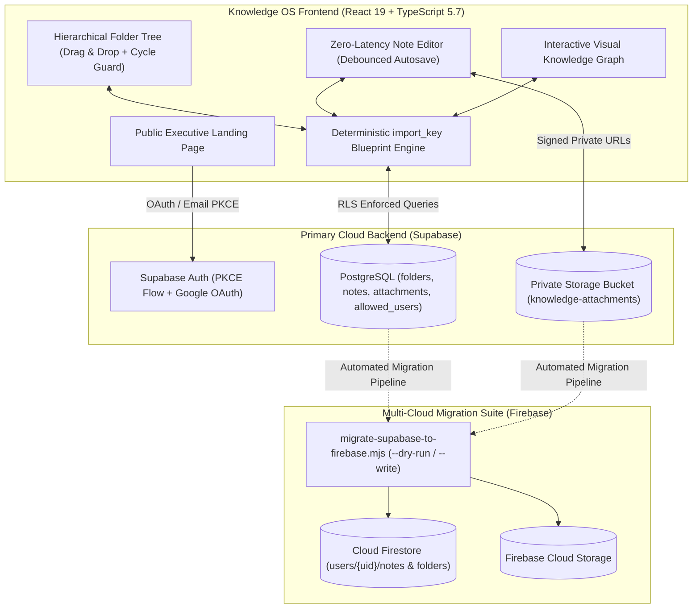

# Jamal Knowledge OS — Private Second Brain, Interactive Knowledge Graph & Multi-Cloud Vault

[](https://www.typescriptlang.org/)
[](https://react.dev/)
[](https://vitejs.dev/)
[](https://supabase.com/)
[](https://firebase.google.com/)
[](https://knowledge.jamaldrenthe.com)

**Jamal Knowledge OS** (`knowledge.jamaldrenthe.com`) is een privé, cloud-gesynchroniseerd Knowledge Operating System dat een minimalistische notitie-omgeving combineert met relationele graafstructuren. Het platform biedt een geneste mappenboom voor 25+ holding-entiteiten, bidirectionele notitielinks, een interactieve **Knowledge Graph**, versleutelde privé-bijlagen, idempotente blueprint-synchronisatie (`import_key`) en toegangscontrole op basis van PostgreSQL Row-Level Security (RLS) én een Firebase migratiesuite.

---

## Technische Kernpunten

1. **Idempotente Blueprint Reconciliatie & Self-Healing Mappenboom (`src/App.tsx`, migraties `001`–`005`)**:
   - Bevat een deterministisch `import_key` reconciliatie-algoritme (`inferImportedFolderKey`) dat een hiërarchische blauwdruk van 25+ ondernemingen (*Quantum Initium, CRMos, Djobba, Investbotiq, VVC, WoningVry, Xabi World, CloudiAudi, CyberSec360, Overskilled, Prompt DJ*, etc.) synchroniseert met de cloud-database zonder ooit duplicaten te creëren bij gelijktijdige sessies of schema-upgrades.
   - Ondersteunt diepe mappen-nesting met cyclus-preventie (`isDescendantFolder`), kleurcodering en drag-and-drop positiebepaling (`position`).
2. **Interactieve Knowledge Graph & Verbonden Denken**:
   - Analyseert relaties tussen notities, mappen en gedeelde `#tags` om de volledige kennisbank te renderen als een interactieve netwerkgrafiek waarmee verbanden tussen verschillende ondernemingen en strategieën direct inzichtelijk worden.
3. **Zero-Trust Single-Owner Security Model (`002_allowed_users.sql` & `firebase/firestore.rules`)**:
   - Naast standaard `auth.uid() = user_id` isolatie dwingt de database via **PostgreSQL Row-Level Security (RLS)** én een server-side `allowed_users` whitelist af dat uitsluitend geautoriseerde directie-identiteiten lees- of schrijftoegang krijgen tot notities en de privé storage-bucket (`knowledge-attachments`).
4. **Multi-Cloud Draagbaarheid (Supabase Live + Volledige Firebase Migratie-Infrastructuur)**:
   - Bevat naast de vijf productie-SQL-migraties in `supabase/migrations/` een volledige, geautomatiseerde migratiepijplijn naar **Google Cloud Firestore & Firebase Storage** (`scripts/migrate-supabase-to-firebase.mjs` met `--dry-run` en `--write` modi, plus geauditeerde `firestore.rules` en `storage.rules`).

---

## Systeemarchitectuur



---

## Kernfunctionaliteiten

- **Hiërarchisch Mappenbeheer**: Onbeperkt geneste mappen met kleurlabels (`violet`, `blue`, `mint`, `amber`), drag-and-drop herordening en automatische kruimelpad-navigatie.
- **Knowledge Graph Visualisatie**: Schakel met één klik tussen de editor-weergave en het interactieve kennisnetwerk om clusters van gerelateerde ideeën, projecten en tags te verkennen.
- **Debounced Realtime Autosave**: Elke toetsaanslag in titel, inhoud of tags wordt optimistisch in de UI bijgewerkt en naadloos op de achtergrond gepersisteerd — inclusief offline-fallback en statusindicator.
- **Privé Bestandsbijlagen (`knowledge-attachments`)**: Upload PDF's, architectuurdiagrammen en documenten rechtstreeks bij een notitie, opgeslagen onder `<user_id>/<attachment_id>/<file_name>` met strikte owner-only bucket-policies.
- **Snelzoeken, Tags & Favorieten**: Filter direct op `#tags`, favoriete notities, mappen of vrije tekst door de volledige inhoud van de vault.
- **Dark & Light Mode**: Rustgevend, contrastrijk design systeem dat zich aanpast aan dag- en avondwerk.

---

## Database Schema & Migraties

De database-evolutie is volledig vastgelegd in [`supabase/migrations/`](supabase/migrations):

1. [`001_knowledge_os.sql`](supabase/migrations/001_knowledge_os.sql): Kerntabellen (`folders`, `notes`, `attachments`), foreign-key cascades, `updated_at` triggers en initiële RLS-policies.
2. [`002_allowed_users.sql`](supabase/migrations/002_allowed_users.sql): Whitelist-tabel `allowed_users` en aangescherpte RLS-functies voor strikte eigenaarstoegang.
3. [`003_folder_positions.sql`](supabase/migrations/003_folder_positions.sql): Expliciete `position` indexering voor deterministische drag-and-drop mapvolgorde.
4. [`004_imported_note_identity.sql`](supabase/migrations/004_imported_note_identity.sql): Unieke `(user_id, import_key)` index op `notes` voor idempotente document-imports.
5. [`005_folder_import_identity.sql`](supabase/migrations/005_folder_import_identity.sql): Unieke `(user_id, import_key)` constraint op `folders` met automatische deduplicatie van bestaande mappen.

---

## Tech Stack

| Categorie | Technologieën |
| :--- | :--- |
| **Frontend** | React 19.0, TypeScript 5.7, Vite 6.0, Lucide React Icons, Custom CSS Design System (`src/styles.css`) |
| **Primaire Backend** | Supabase (`@supabase/supabase-js` v2.117), PostgreSQL 15+, Row-Level Security (RLS), Supabase Storage |
| **Secundaire Cloud / Migratie** | Firebase Firestore (`firebase/firestore.rules`), Firebase Storage (`firebase/storage.rules`), Node.js ESM Migratie CLI |
| **Hosting & Beveiliging** | Cloudflare Pages (`knowledge.jamaldrenthe.com`) met aangepaste CSP-headers en zelfstandige merkeigen 404-afhandeling |

---

## Lokaal Ontwikkelen & Uitvoeren

### Vereisten
- **Node.js** v20+ en `npm`

### 1. Installeren & Ontwikkelserver Starten
```bash
git clone https://github.com/JamalDrenthe/Jamal-Knowledge-OS.git
cd Jamal-Knowledge-OS
npm install
npm run dev
```
Zonder geconfigureerde Supabase-sleutels start de applicatie automatisch in een volledig interactieve **Local Vault Demo-modus** zodat alle functies (mappenboom, editor, tags en Knowledge Graph) direct te testen zijn.

### 2. Omgevingsvariabelen (`.env.local`)
Voor live cloud-persistentie met Supabase:
```env
VITE_SUPABASE_URL=https://<project-ref>.supabase.co
VITE_SUPABASE_ANON_KEY=eyJhbGciOi...
```

### 3. Build & Typecheck
```bash
npm run lint      # Voert tsc --noEmit uit
npm run build     # TypeScript compilatie + Vite productiebuild
npm run preview   # Serveert de productiebuild lokaal
```

---

## Auteur & Contact

Ontworpen en ontwikkeld door **Jamal Drenthe** ([Quantum Initium](https://quantuminitium.com)).

- **Website**: [knowledge.jamaldrenthe.com](https://knowledge.jamaldrenthe.com)
- **GitHub**: [@JamalDrenthe](https://github.com/JamalDrenthe)
- **E-mail**: [info@jamaldrenthe.com](mailto:info@jamaldrenthe.com)
